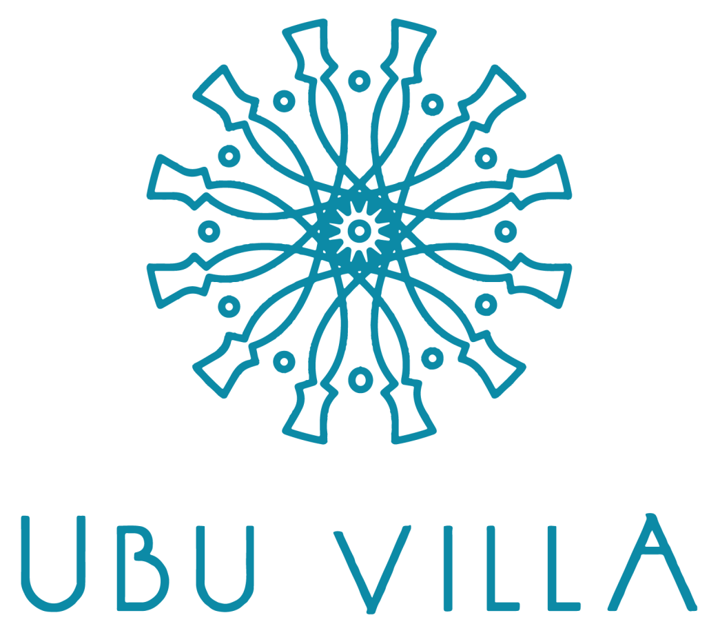

# 🏝️ Ubu Hospitality Platform & Multi-Brand Property Management CMS

<p align="center">
  
</p>

<p align="center">
  <strong>Platform Hospitality Terpadu & Multi-Brand Villa Management System</strong><br>
  Dirancang khusus untuk pengelolaan portofolio properti mewah, reservasi eksklusif, dan ekosistem kemitraan perhotelan di Yogyakarta.
</p>

<p align="center">
  
  
  
  
  
  
</p>

---

## 📌 Sekilas Tentang Proyek

**Ubu Hospitality Platform** adalah sistem manajemen perhotelan, villa, dan resort berbasis web modern yang menggabungkan portal publik bertaraf internasional dengan sistem back-office CMS (*Content Management System*) yang komprehensif.

Aplikasi ini menyatukan portofolio multi-brand di bawah naungan **PT Ubu Hospitality Indonesia**, antara lain:
* 🏛️ **Ubu Villa**: Koleksi villa mewah bertema unik dengan kolam renang privat (*Private Pool Luxury Thematic Villas*).
* 🕌 **Buruj Villa**: Villa keluarga dengan kepatuhan syariah penuh (*Family Syariah Compliant Luxury Villas*).
* ⛺ **Ubu Glamping**: Liburan alam terbuka bernuansa mewah (*Nature & Luxury Glamping Escape*).

---

## ✨ Fitur Unggulan Sistem

### 🌐 1. Portal Publik (Guest-Facing Experience)
* **Navbar & Draw Menu Responsif**: Navigasi ultra-ramping di mobile dengan transisi *smooth slide-in drawer*, kartu pencarian instan, dan penataan hierarki menu modern.
* **Interactive Luxury Search Widget**: Pemilihan tanggal fleksibel dengan Flatpickr bertema Indonesia, popover interaktif jumlah tamu (Dewasa & Anak bergaya Airbnb), serta filter kategori cepat.
* **Master Brands Showcase**: Navigasi khusus antar brand properti dengan kurasi suasana, fasilitas, dan galeri visual autentik.
* **Jelajahi Lokasi (Destinasi Yogyakarta)**: Eksplorasi kawasan wisata terbaik (Sleman, Kaliurang, Bantul, dan Kota Yogyakarta) yang terhubung langsung dengan foto landmark asli beresolusi tinggi.
* **Pengalaman Istimewa Selama Menginap**: Kurasi aktivitas pelengkap seperti *In-Villa Floating Breakfast*, *Merapi Lava Tour Jeep*, *Private BBQ Dinner*, dan layanan *Spa & Wellness*.
* **Celebrity Staycation**: Menampilkan galeri kunjungan figur publik dan *influencer* ternama.
* **Penawaran & Kupon Diskon**: Sistem kupon selamat datang (`UBUWELCOME` Diskon 15%) dengan fitur salin kode otomatis.
* **Portal Kemitraan (Partnership)**: Edukasi skema bagi hasil, model kerja sama pengelolaan villa, dan formulir pengajuan properti terintegrasi.
* **Partner Pembayaran Resmi**: Dukungan metode pembayaran terverifikasi (BCA, BNI, Mandiri, BRI, BRIVA, Mastercard, AMEX, ATM Bersama, Prima, LinkAja, Indomaret, Alfamart) yang terintegrasi dengan standar keamanan DOKU & SENTEC.
* **Sidebar Filter Properti Publik**: Filter sticky pada desktop dan *Mobile Filter Draw Menu* di smartphone sehingga listing properti tidak tertutup form panjang.
* **Dukungan Multi-Bahasa**: Pilihan bahasa dinamis Indonesia (ID) dan Inggris (EN).

### 🛠️ 2. Admin CMS Platform (Hospitality & Asset Management)
* **Dashboard Operasional**: Statistik total properti, brand aktif, prospek kemitraan baru, dan artikel blog terpublikasi.
* **Manajemen Properti Komprehensif**: CRUD properti lengkap dengan galeri foto berganda, tarif dinamis, tipe kamar tidur & kamar mandi, fasilitas (amenities), lokasi, serta embed video YouTube 360° dan Google Maps.
* **Sistem Upload Media Tanpa Symlink (`storage:link`)**: Arsitektur pemrosesan media langsung dengan kompresi WebP otomatis, resize resolusi tinggi, dual-saving ke disk, dan streaming route berkecepatan tinggi dengan HTTP caching (`Cache-Control: immutable, max-age=31536000`).
* **Manajemen Brand & Destinasi**: Pengaturan logo, cover banner, deskripsi, dan integrasi brand.
* **Pipeline Prospek Kemitraan**: Manajemen status pengajuan villa dari pemilik properti (*New Lead*, *Contacted*, *Surveying*, *Negotiation*, *Deal Closed*).
* **Manajemen Promosi & Pengalaman**: Pengaturan kupon diskon, promosi pop-up banner, dan paket layanan *in-villa*.
* **Blog & Panduan Perjalanan**: Publikasi artikel SEO-friendly dengan kategori dan tags.
* **Tata Kelola Web Dinamis**: Manajemen halaman statis, navigasi header/footer, media library, dan SEO meta tags.
* **Sistem Audit Log**: Pencatatan riwayat setiap aksi penting pada sistem untuk transparansi operasional.
* **Sidebar Admin Proporsional**: Sidebar responsif dengan user card footer pada desktop dan *Offcanvas Slide Drawer* lengkap dengan *backdrop blur* pada perangkat mobile.

---

## 🏗️ Arsitektur & Teknologi

| Komponen | Spesifikasi & Teknologi |
| :--- | :--- |
| **Backend Framework** | Laravel 12.x (PHP 8.4+) |
| **Database** | MySQL 8.0+ / SQLite untuk Automated Testing |
| **Frontend Styling** | Custom CSS Architecture (`variables.css`, `components.css`, `public.css`, `admin.css`) |
| **UI Component Library** | Bootstrap 5.3.3 + Bootstrap Icons 1.11.3 |
| **Interactive Widgets** | Flatpickr Datepicker, SweetAlert2 Flash Notifications |
| **Asset Bundler** | Vite v8.3+ |
| **Testing Engine** | Pest PHP Testing Framework (42 Feature Tests, 266 Assertions, 100% Passing) |
| **Code Standard** | PSR-12 terstandarisasi via Laravel Pint |

---

## 🚀 Panduan Instalasi & Menjalankan Lokal

### 1. Kebutuhan Sistem
* PHP 8.4 atau lebih baru (dengan ekstensi `pdo_mysql`, `mbstring`, `openssl`, `gd`, `fileinfo`)
* Composer 2.x
* Web Server (Apache via XAMPP atau Nginx)
* MySQL / MariaDB Database Server
* Node.js & npm (v18+)

### 2. Kloning Repositori
```bash
git clone https://github.com/ardhikaxx/ubu-hospitality.git
cd ubu-hospitality
```

### 3. Instalasi Dependensi PHP & JavaScript
```bash
composer install
npm install
```

### 4. Konfigurasi Lingkungan (.env)
Salin berkas konfigurasi `.env.example`:
```bash
cp .env.example .env
php artisan key:generate
```
Sesuaikan konfigurasi database Anda pada berkas `.env`:
```env
DB_CONNECTION=mysql
DB_HOST=127.0.0.1
DB_PORT=3306
DB_DATABASE=ubu_hospitality
DB_USERNAME=root
DB_PASSWORD=
```

### 5. Migrasi & Seeding Database
Jalankan migrasi dan seeder untuk menyiapkan seluruh data asli Ubu Villa (brand, properti, foto lokal, blog, FAQ, dan destinasi):
```bash
php artisan migrate:fresh --seed
```

### 6. Kompilasi Aset Frontend
```bash
npm run build
```
*(Untuk mode pengembangan aktif dengan auto-reload, jalankan `npm run dev`)*

### 7. Jalankan Server
```bash
php artisan serve
```
Buka browser Anda dan akses portal publik di: `http://127.0.0.1:8000`  
Halaman login Admin CMS: `http://127.0.0.1:8000/admin/login`

---

## 🔑 Akun Demo Admin CMS

| Role | Email Akses | Kata Sandi | URL Login |
| :--- | :--- | :--- | :--- |
| **Super Administrator** | `admin@ubuhospitality.com` | `AdminUbu2026!` | [`/admin/login`](http://127.0.0.1:8000/admin/login) |

---

## 🧪 Pengujian Sistem (Automated Tests)

Proyek ini dilengkapi dengan 42 pengujian fitur otomatis (*Feature Tests*) menggunakan **Pest PHP**:
```bash
# Menjalankan seluruh rangkaian tes
php artisan test --compact

# Menjalankan tes upload media tanpa storage:link
php artisan test --filter=ImageUploadWithoutStorageLinkTest

# Menjalankan tes responsivitas halaman publik dan navbar
php artisan test --filter=PublicPagesTest

# Format kode otomatis menggunakan Laravel Pint
vendor/bin/pint --format agent
```

---

## 📚 Dokumen Pendukung

* [📋 **CHANGELOG.md**](./CHANGELOG.md) — Riwayat pembaruan dan rilis fitur.
* [📚 **CITATION.md**](./CITATION.md) — Format sitasi akademik karya ini (APA, BibTeX, IEEE, MLA).
* [📜 **CODE_OF_CONDUCT.md**](./CODE_OF_CONDUCT.md) — Pedoman perilaku dan etika komunitas.
* [🤝 **CONTRIBUTING.md**](./CONTRIBUTING.md) — Standar kontribusi kode dan alur kerja Git.
* [🛡️ **SECURITY.md**](./SECURITY.md) — Kebijakan keamanan dan pelaporan celah.
* [💬 **SUPPORT.md**](./SUPPORT.md) — Kanal bantuan teknis, konsultasi, dan kustomisasi sistem.

---

## 💖 Dukungan & Donasi

Jika proyek **Ubu Hospitality Platform** ini bermanfaat bagi Anda dan telah membantu mempercepat pengembangan sistem manajemen perhotelan atau villa Anda, Anda dapat menunjukkan apresiasi dengan memberikan donasi sukarela (traktiran kopi) melalui pemindaian kode **QRIS** di bawah ini:

<p align="center">
  
</p>

> Donasi sepenuhnya bersifat sukarela dan tidak mengikat. Seluruh fitur sistem tetap dapat digunakan secara penuh tanpa kewajiban donasi.

---

## ⚠️ Ketentuan Penggunaan & Lisensi

Proyek ini dilindungi lisensi **Proprietary Software License (All Rights Reserved)**. Anda dilarang keras menyalin, mendistribusikan ulang, menghapus atribusi hak cipta, atau memperjualbelikan kode ini tanpa izin tertulis dari pemilik hak cipta.

---

## 👨‍💻 Pengembang & Hak Cipta

Dirancang dan dikembangkan dengan dedikasi tinggi oleh:  
**[Yanuar Ardhika Rahmadhani Ubaidillah (@ardhikaxx)](https://github.com/ardhikaxx)**  
*Lead Software Architect & Maintainer*  
Email: `ardhikayanuar58@gmail.com`

> **Copyright (c) 2026 PT Ubu Hospitality Indonesia & Yanuar Ardhika Rahmadhani Ubaidillah (@ardhikaxx). All Rights Reserved.**
